# WU008 — Authentic PersianGravity admin UI evidence

Captured by licensed disposable WU008 WordPress/Chromium, not a mock or static HTML rendering.
Each thumbnail opens the underlying full-page JPEG in this permanent evidence branch.
A browser capture is not a claim that every associated interaction works.

## Exact context

| Field | Observed |
| --- | --- |
| Source Head | `ba3fb9cd40bbde27466e3f7a082c8bfd909c6972` |
| PHP | `8.2.35` |
| WordPress | `6.8.3` |
| Plugin versions | `{"gravityforms":"3.1.1.1","gravityflow":"3.1.0","gravityview":"3.3.4","persiangravity":"4.10.0","gravityperks":"2.3.16","gpfileuploadpro":"1.5.13","gpadvancedselect":"1.1.21"}` |
| Browser | Chromium `140.0.7339.16` / Playwright `1.55.0` |
| DPR | 1 |
| Locale & directions | WordPress fa_IR/RTL; en_US/LTR, separately captured |
| Viewports | 1280x900, 390x844, focused 320x700 |

## State matrix and clickable contact sheets

### fa_IR — normal

| Screen / width | Screenshot | Overflow detector |
| --- | --- | --- |
| overview @ 1280 | [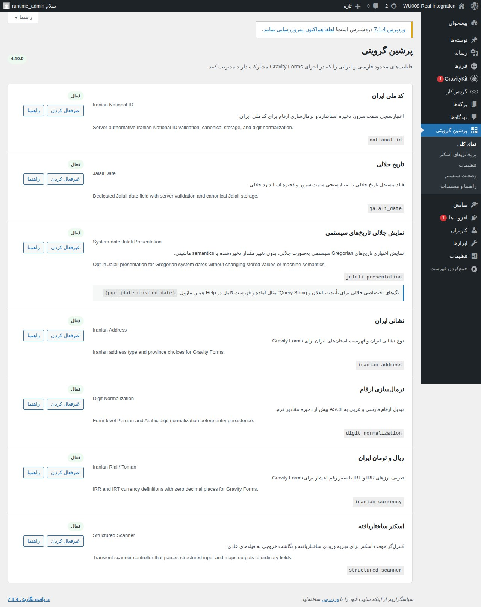](ui-normal-fa_IR-overview-1280.jpg) | CAPTURED_NO_DETECTED_OVERFLOW (scrollWidth=1280) |
| profiles-list @ 1280 | [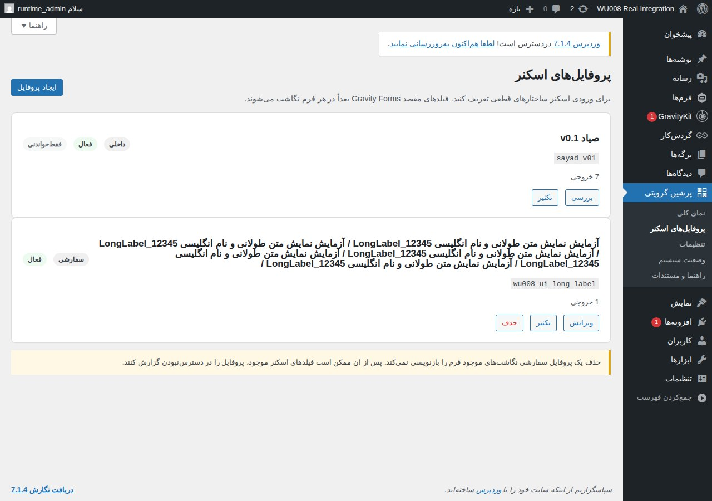](ui-normal-fa_IR-profiles-list-1280.jpg) | CAPTURED_NO_DETECTED_OVERFLOW (scrollWidth=1280) |
| profiles-new @ 1280 | [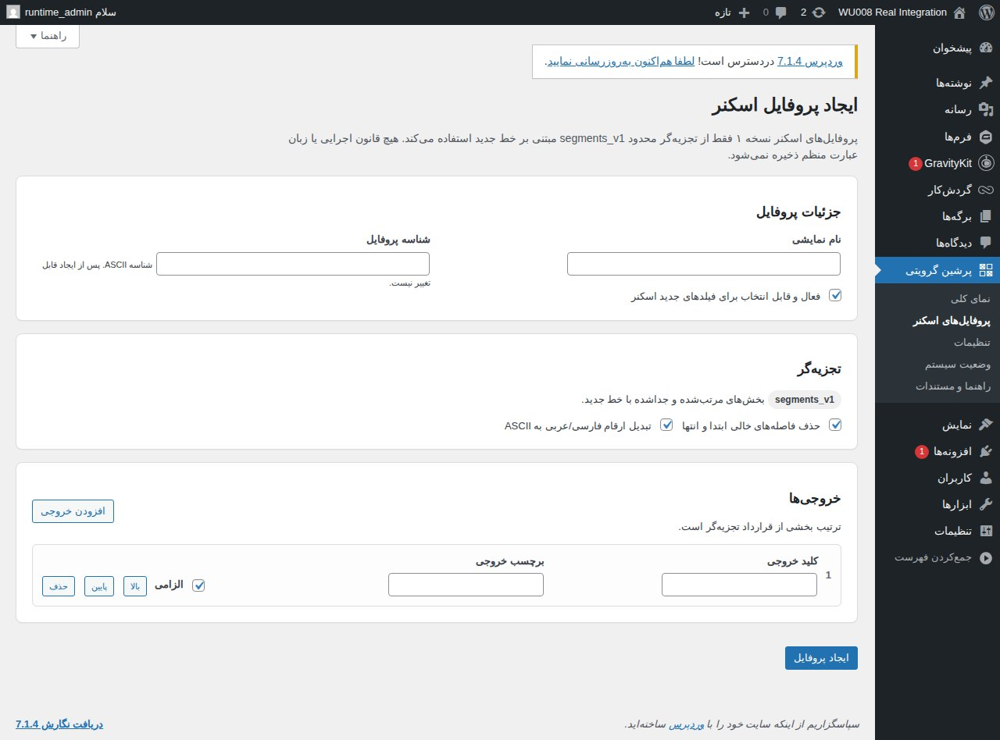](ui-normal-fa_IR-profiles-new-1280.jpg) | CAPTURED_NO_DETECTED_OVERFLOW (scrollWidth=1280) |
| profiles-edit @ 1280 | [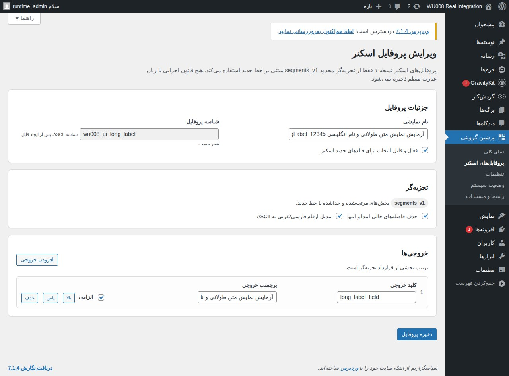](ui-normal-fa_IR-profiles-edit-1280.jpg) | CAPTURED_NO_DETECTED_OVERFLOW (scrollWidth=1280) |
| profiles-built-in @ 1280 | [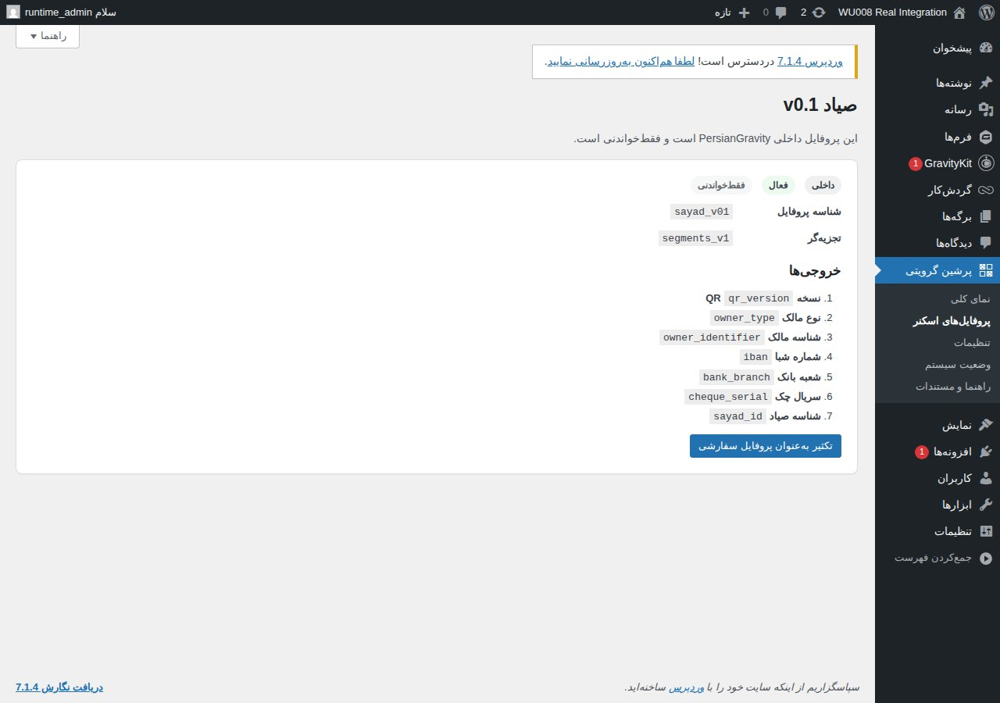](ui-normal-fa_IR-profiles-built-in-1280.jpg) | CAPTURED_NO_DETECTED_OVERFLOW (scrollWidth=1280) |
| settings @ 1280 | [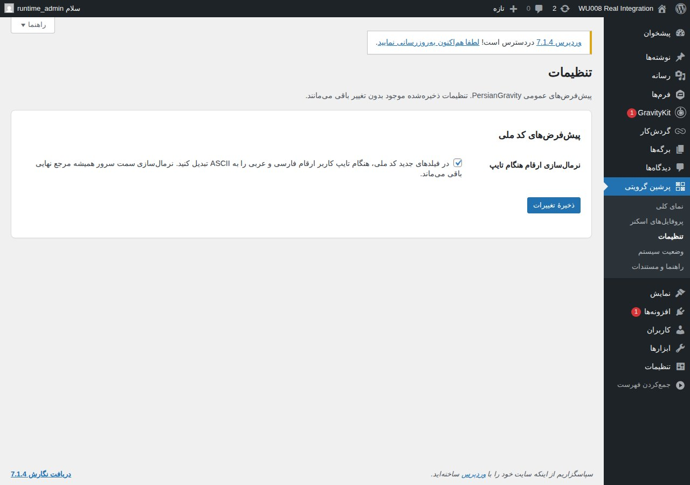](ui-normal-fa_IR-settings-1280.jpg) | CAPTURED_NO_DETECTED_OVERFLOW (scrollWidth=1280) |
| system-status @ 1280 | [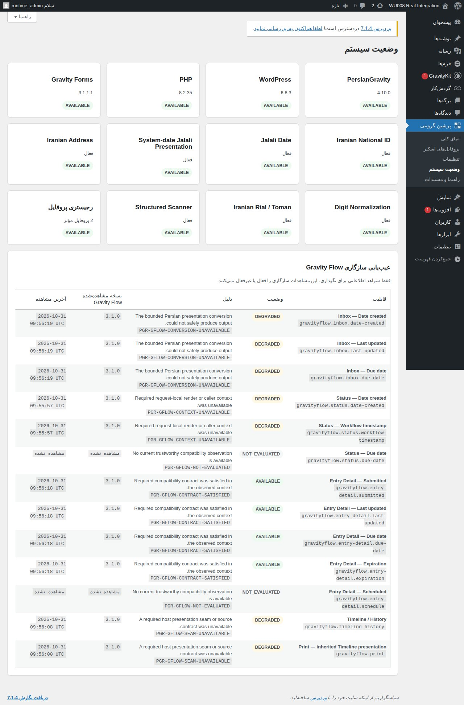](ui-normal-fa_IR-system-status-1280.jpg) | CAPTURED_NO_DETECTED_OVERFLOW (scrollWidth=1280) |
| module-confirm @ 1280 | [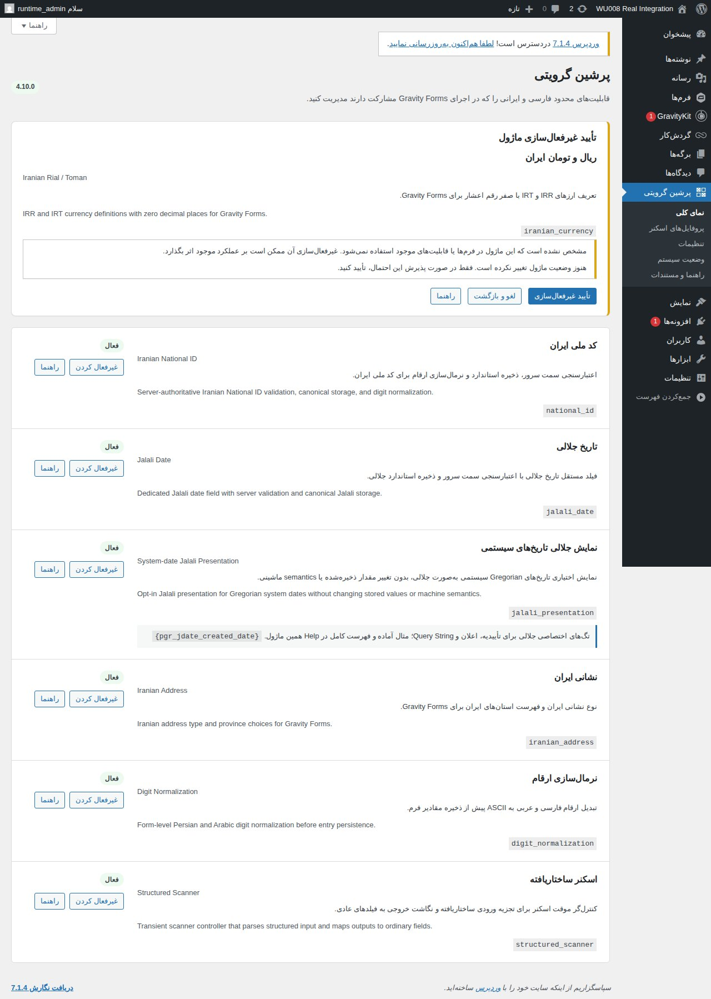](ui-normal-fa_IR-module-confirm-1280.jpg) | CAPTURED_NO_DETECTED_OVERFLOW (scrollWidth=1280) |
| overview @ 390 | [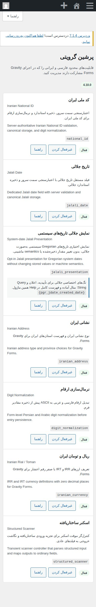](ui-normal-fa_IR-overview-390.jpg) | CAPTURED_NO_DETECTED_OVERFLOW (scrollWidth=390) |
| profiles-list @ 390 | [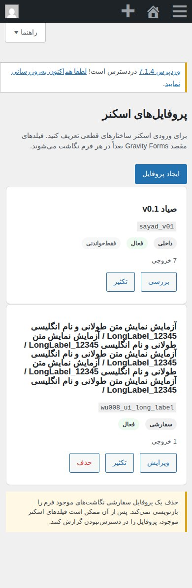](ui-normal-fa_IR-profiles-list-390.jpg) | CAPTURED_NO_DETECTED_OVERFLOW (scrollWidth=390) |
| profiles-new @ 390 | [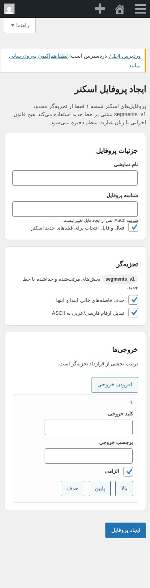](ui-normal-fa_IR-profiles-new-390.jpg) | CAPTURED_NO_DETECTED_OVERFLOW (scrollWidth=390) |
| profiles-edit @ 390 | [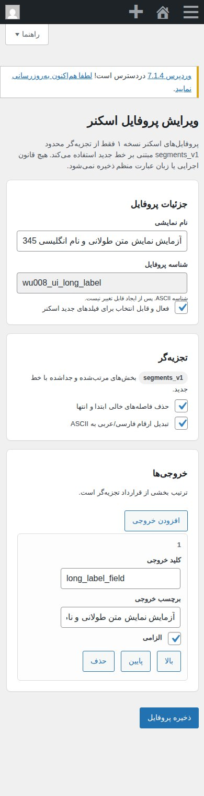](ui-normal-fa_IR-profiles-edit-390.jpg) | CAPTURED_NO_DETECTED_OVERFLOW (scrollWidth=390) |
| profiles-built-in @ 390 | [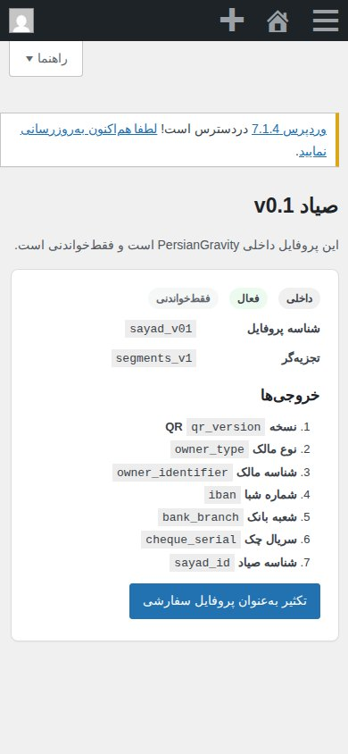](ui-normal-fa_IR-profiles-built-in-390.jpg) | CAPTURED_NO_DETECTED_OVERFLOW (scrollWidth=390) |
| settings @ 390 | [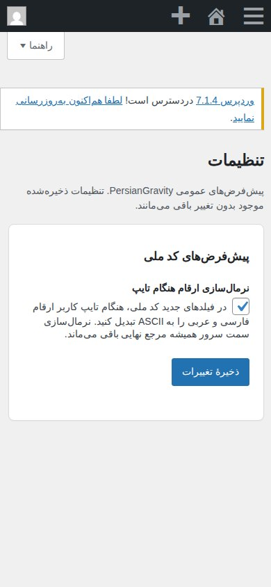](ui-normal-fa_IR-settings-390.jpg) | CAPTURED_NO_DETECTED_OVERFLOW (scrollWidth=390) |
| system-status @ 390 | [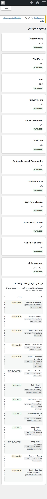](ui-normal-fa_IR-system-status-390.jpg) | VISUAL_FINDING (scrollWidth=390) |
| module-confirm @ 390 | [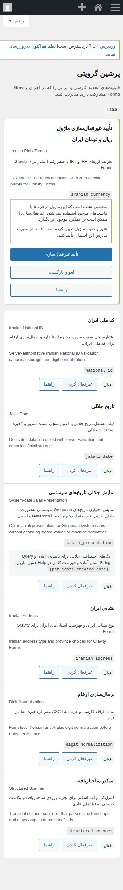](ui-normal-fa_IR-module-confirm-390.jpg) | CAPTURED_NO_DETECTED_OVERFLOW (scrollWidth=390) |
| overview @ 320 | [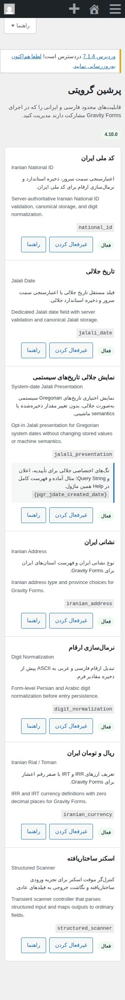](ui-normal-fa_IR-overview-320.jpg) | CAPTURED_NO_DETECTED_OVERFLOW (scrollWidth=320) |
| profiles-edit @ 320 | [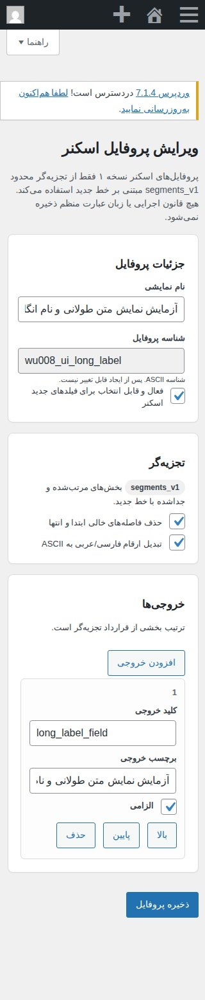](ui-normal-fa_IR-profiles-edit-320.jpg) | CAPTURED_NO_DETECTED_OVERFLOW (scrollWidth=320) |
| system-status @ 320 | [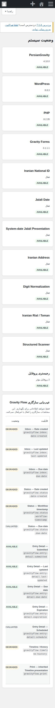](ui-normal-fa_IR-system-status-320.jpg) | VISUAL_FINDING (scrollWidth=320) |
| module-confirm @ 320 | [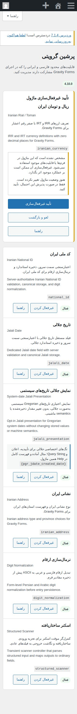](ui-normal-fa_IR-module-confirm-320.jpg) | CAPTURED_NO_DETECTED_OVERFLOW (scrollWidth=320) |

**Diagnostics classification:** VISUAL_FINDING means an overflow candidate was observed; it is not silently accepted as a UI pass. CAPTURED_NO_DETECTED_OVERFLOW means only the measured page/element overflow checks were negative.

### en_US — normal

| Screen / width | Screenshot | Overflow detector |
| --- | --- | --- |
| overview @ 1280 | [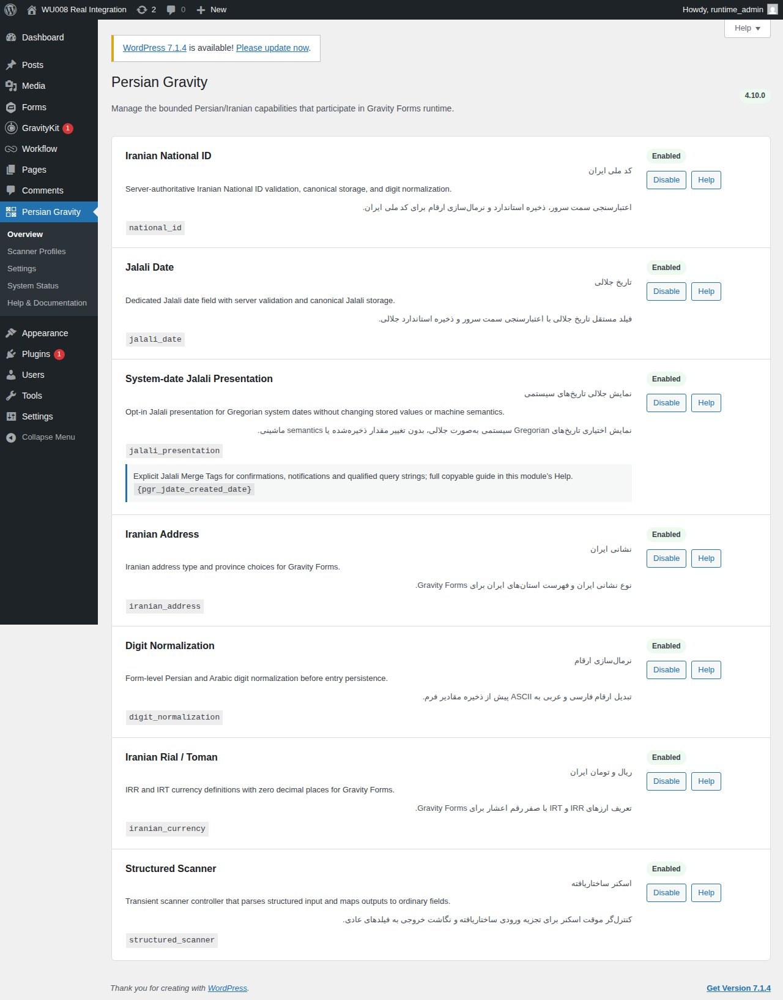](ui-normal-en_US-overview-1280.jpg) | CAPTURED_NO_DETECTED_OVERFLOW (scrollWidth=1280) |
| profiles-list @ 1280 | [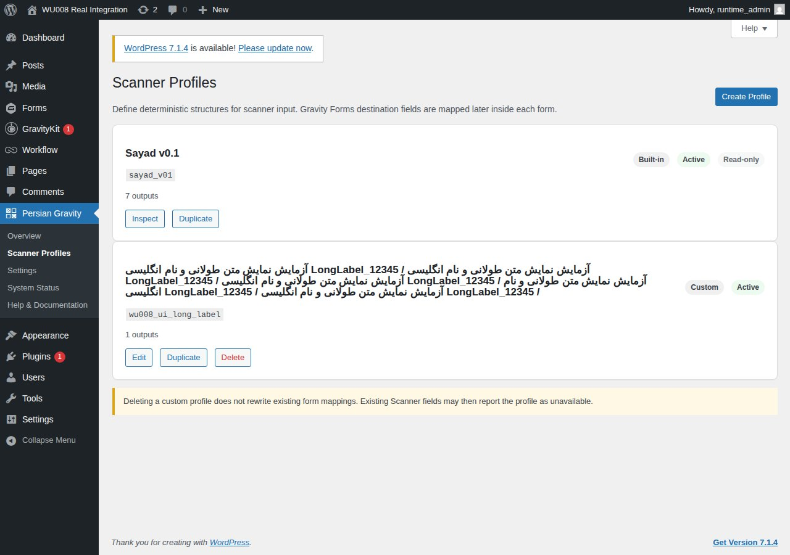](ui-normal-en_US-profiles-list-1280.jpg) | CAPTURED_NO_DETECTED_OVERFLOW (scrollWidth=1280) |
| profiles-new @ 1280 | [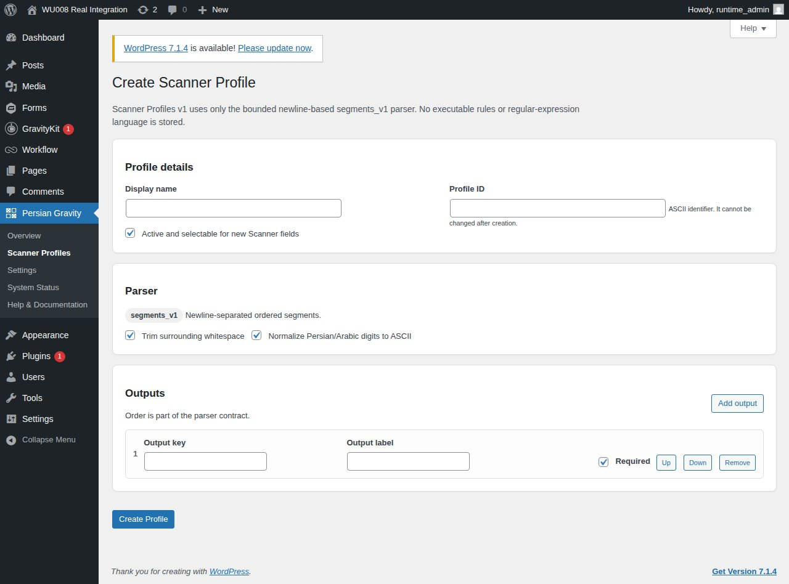](ui-normal-en_US-profiles-new-1280.jpg) | CAPTURED_NO_DETECTED_OVERFLOW (scrollWidth=1280) |
| profiles-edit @ 1280 | [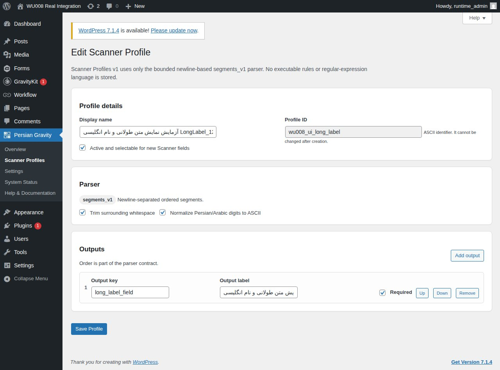](ui-normal-en_US-profiles-edit-1280.jpg) | CAPTURED_NO_DETECTED_OVERFLOW (scrollWidth=1280) |
| profiles-built-in @ 1280 | [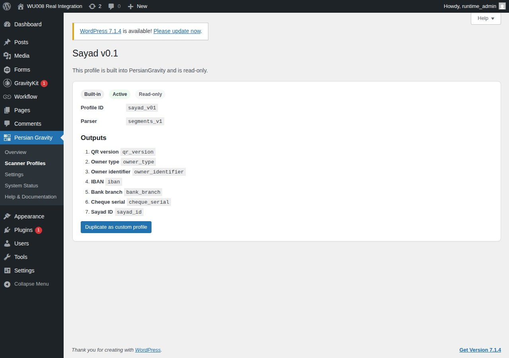](ui-normal-en_US-profiles-built-in-1280.jpg) | CAPTURED_NO_DETECTED_OVERFLOW (scrollWidth=1280) |
| settings @ 1280 | [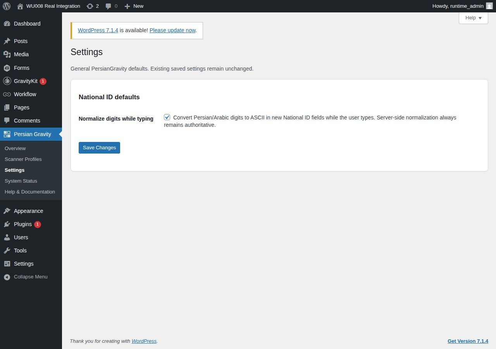](ui-normal-en_US-settings-1280.jpg) | CAPTURED_NO_DETECTED_OVERFLOW (scrollWidth=1280) |
| system-status @ 1280 |  | CAPTURED_NO_DETECTED_OVERFLOW (scrollWidth=1280) |
| module-confirm @ 1280 | [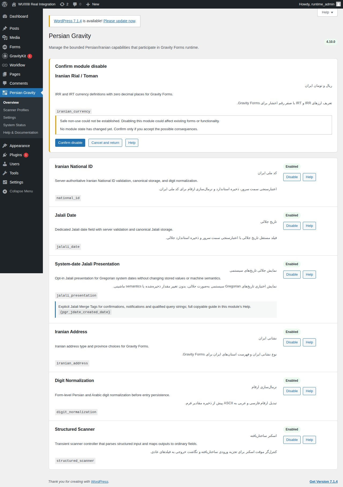](ui-normal-en_US-module-confirm-1280.jpg) | CAPTURED_NO_DETECTED_OVERFLOW (scrollWidth=1280) |
| overview @ 390 | [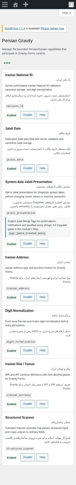](ui-normal-en_US-overview-390.jpg) | CAPTURED_NO_DETECTED_OVERFLOW (scrollWidth=390) |
| profiles-list @ 390 | [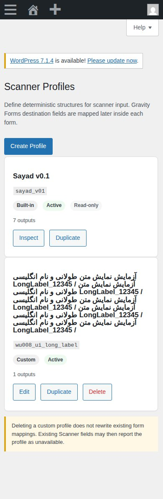](ui-normal-en_US-profiles-list-390.jpg) | CAPTURED_NO_DETECTED_OVERFLOW (scrollWidth=390) |
| profiles-new @ 390 | [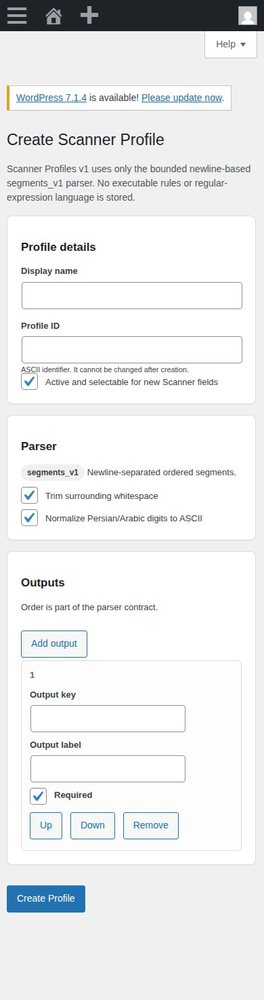](ui-normal-en_US-profiles-new-390.jpg) | CAPTURED_NO_DETECTED_OVERFLOW (scrollWidth=390) |
| profiles-edit @ 390 | [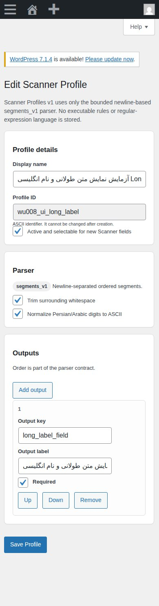](ui-normal-en_US-profiles-edit-390.jpg) | CAPTURED_NO_DETECTED_OVERFLOW (scrollWidth=390) |
| profiles-built-in @ 390 | [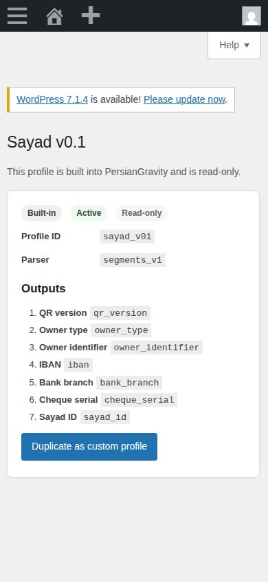](ui-normal-en_US-profiles-built-in-390.jpg) | CAPTURED_NO_DETECTED_OVERFLOW (scrollWidth=390) |
| settings @ 390 | [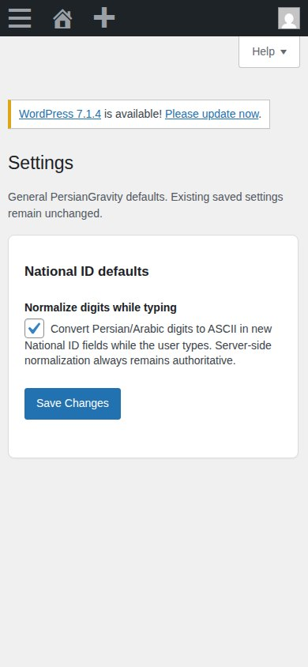](ui-normal-en_US-settings-390.jpg) | CAPTURED_NO_DETECTED_OVERFLOW (scrollWidth=390) |
| system-status @ 390 | [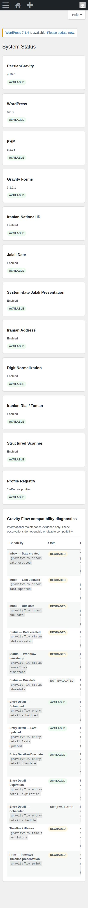](ui-normal-en_US-system-status-390.jpg) | VISUAL_FINDING (scrollWidth=390) |
| module-confirm @ 390 | [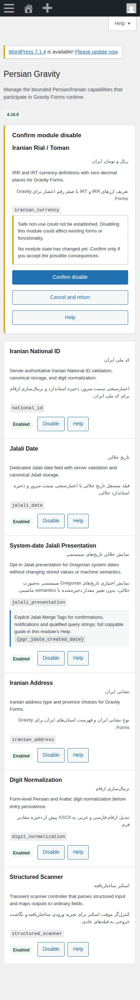](ui-normal-en_US-module-confirm-390.jpg) | CAPTURED_NO_DETECTED_OVERFLOW (scrollWidth=390) |
| overview @ 320 | [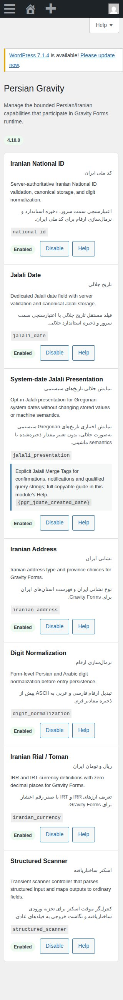](ui-normal-en_US-overview-320.jpg) | CAPTURED_NO_DETECTED_OVERFLOW (scrollWidth=320) |
| profiles-edit @ 320 | [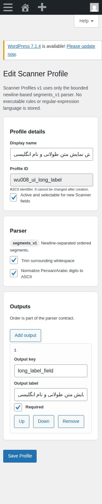](ui-normal-en_US-profiles-edit-320.jpg) | CAPTURED_NO_DETECTED_OVERFLOW (scrollWidth=320) |
| system-status @ 320 | [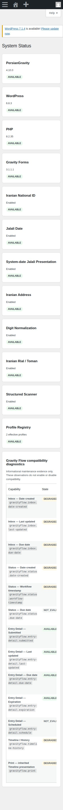](ui-normal-en_US-system-status-320.jpg) | VISUAL_FINDING (scrollWidth=320) |
| module-confirm @ 320 | [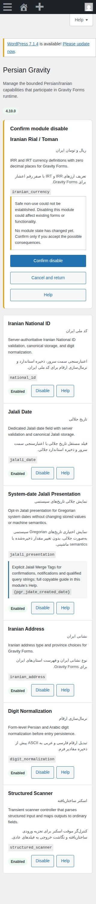](ui-normal-en_US-module-confirm-320.jpg) | CAPTURED_NO_DETECTED_OVERFLOW (scrollWidth=320) |

**Diagnostics classification:** VISUAL_FINDING means an overflow candidate was observed; it is not silently accepted as a UI pass. CAPTURED_NO_DETECTED_OVERFLOW means only the measured page/element overflow checks were negative.

### fa_IR — disabled

| Screen / width | Screenshot | Overflow detector |
| --- | --- | --- |
| overview-disabled @ 1280 | [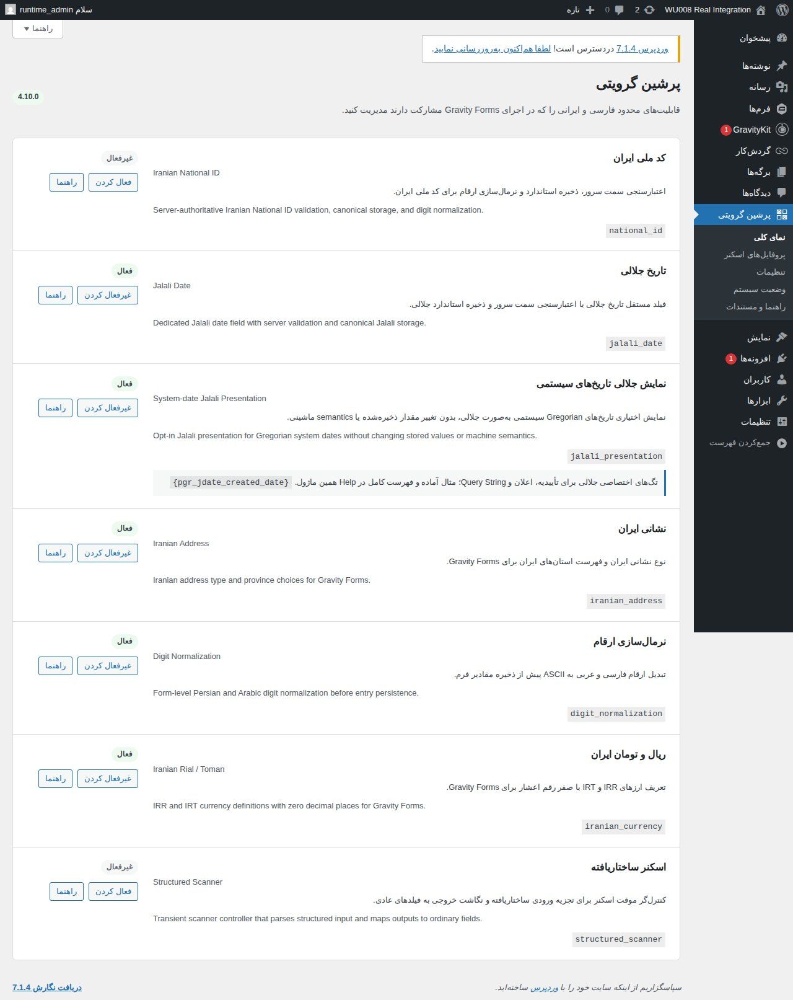](ui-disabled-fa_IR-overview-disabled-1280.jpg) | CAPTURED_NO_DETECTED_OVERFLOW (scrollWidth=1280) |
| profiles-disabled-warning @ 1280 | [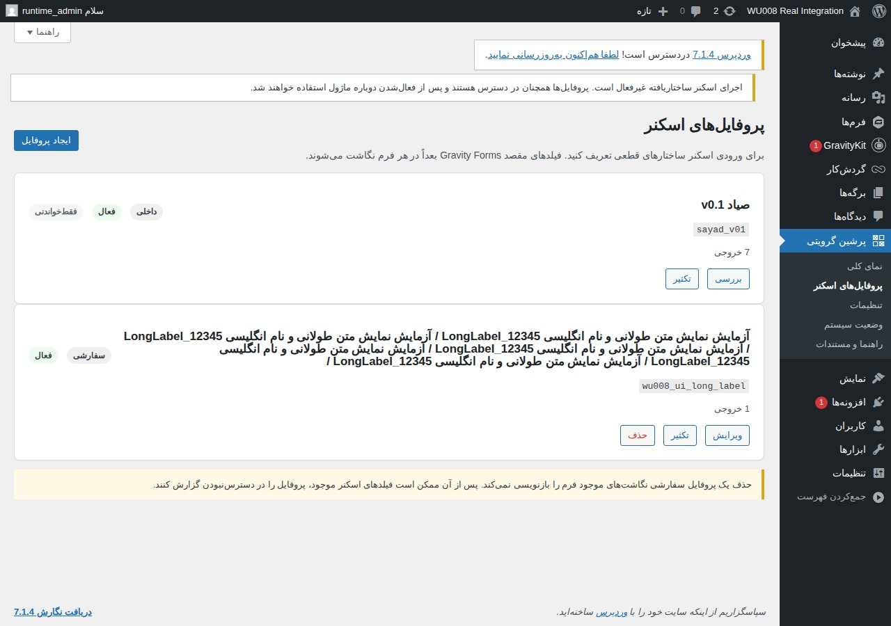](ui-disabled-fa_IR-profiles-disabled-warning-1280.jpg) | CAPTURED_NO_DETECTED_OVERFLOW (scrollWidth=1280) |
| settings-disabled-notice @ 1280 | [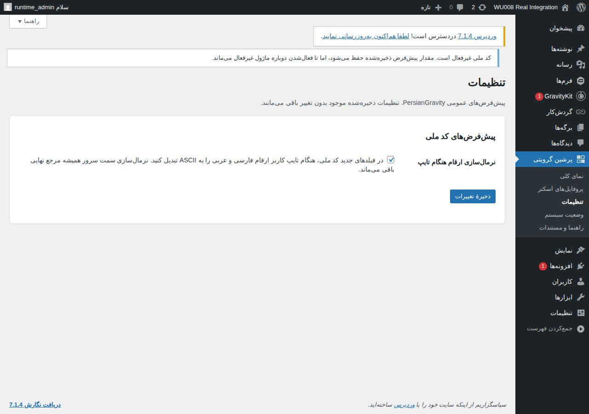](ui-disabled-fa_IR-settings-disabled-notice-1280.jpg) | CAPTURED_NO_DETECTED_OVERFLOW (scrollWidth=1280) |
| system-status-disabled @ 1280 | [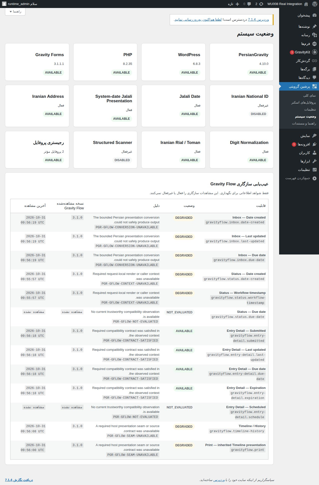](ui-disabled-fa_IR-system-status-disabled-1280.jpg) | CAPTURED_NO_DETECTED_OVERFLOW (scrollWidth=1280) |
| overview-disabled @ 390 | [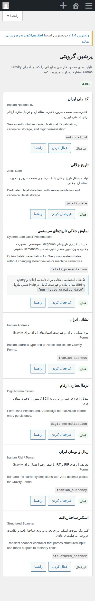](ui-disabled-fa_IR-overview-disabled-390.jpg) | CAPTURED_NO_DETECTED_OVERFLOW (scrollWidth=390) |
| profiles-disabled-warning @ 390 | [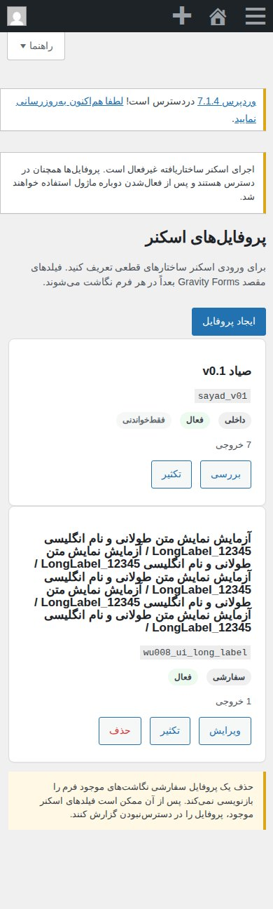](ui-disabled-fa_IR-profiles-disabled-warning-390.jpg) | CAPTURED_NO_DETECTED_OVERFLOW (scrollWidth=390) |
| settings-disabled-notice @ 390 | [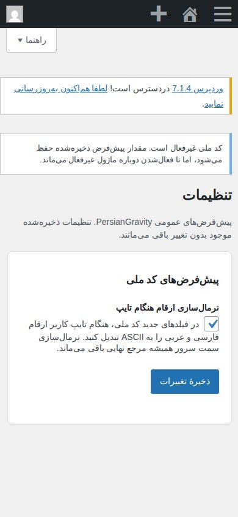](ui-disabled-fa_IR-settings-disabled-notice-390.jpg) | CAPTURED_NO_DETECTED_OVERFLOW (scrollWidth=390) |
| system-status-disabled @ 390 | [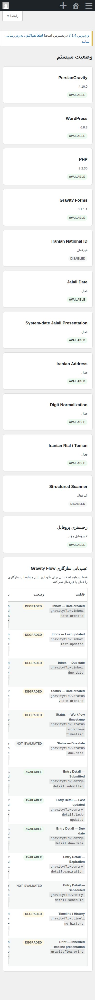](ui-disabled-fa_IR-system-status-disabled-390.jpg) | VISUAL_FINDING (scrollWidth=390) |
| profiles-disabled-warning @ 320 | [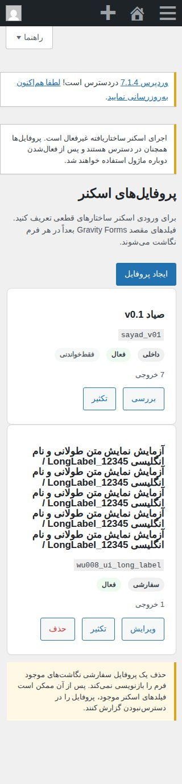](ui-disabled-fa_IR-profiles-disabled-warning-320.jpg) | CAPTURED_NO_DETECTED_OVERFLOW (scrollWidth=320) |
| settings-disabled-notice @ 320 | [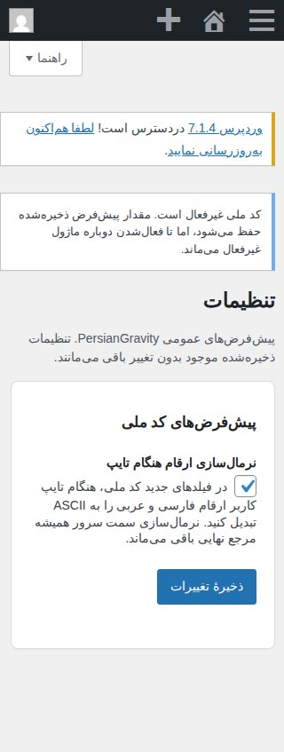](ui-disabled-fa_IR-settings-disabled-notice-320.jpg) | CAPTURED_NO_DETECTED_OVERFLOW (scrollWidth=320) |

**Diagnostics classification:** VISUAL_FINDING means an overflow candidate was observed; it is not silently accepted as a UI pass. CAPTURED_NO_DETECTED_OVERFLOW means only the measured page/element overflow checks were negative.

### en_US — disabled

| Screen / width | Screenshot | Overflow detector |
| --- | --- | --- |
| overview-disabled @ 1280 | [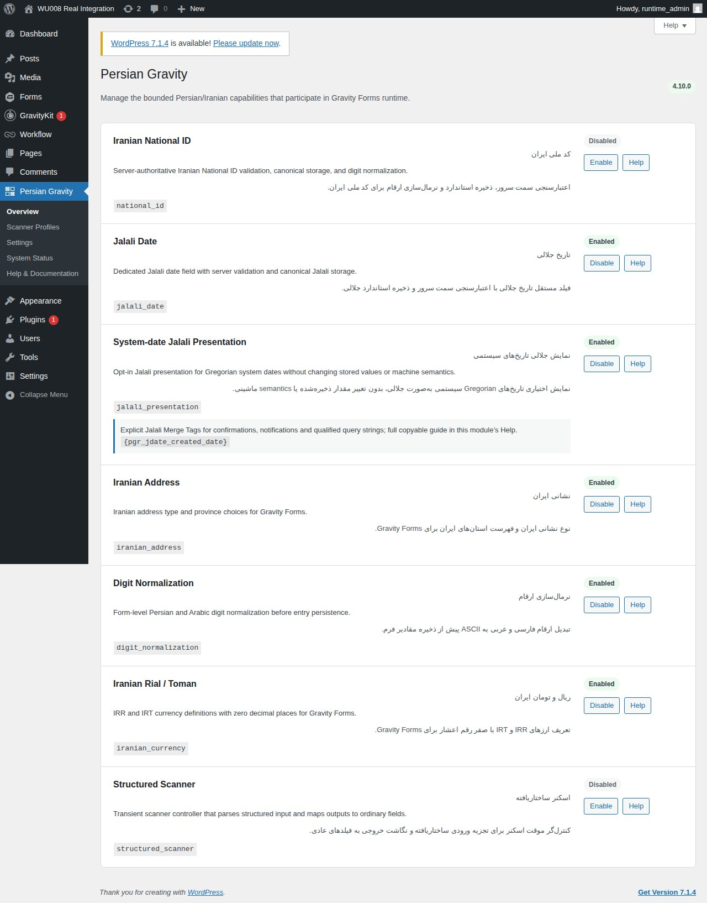](ui-disabled-en_US-overview-disabled-1280.jpg) | CAPTURED_NO_DETECTED_OVERFLOW (scrollWidth=1280) |
| profiles-disabled-warning @ 1280 |  | CAPTURED_NO_DETECTED_OVERFLOW (scrollWidth=1280) |
| settings-disabled-notice @ 1280 |  | CAPTURED_NO_DETECTED_OVERFLOW (scrollWidth=1280) |
| system-status-disabled @ 1280 |  | CAPTURED_NO_DETECTED_OVERFLOW (scrollWidth=1280) |
| overview-disabled @ 390 |  | CAPTURED_NO_DETECTED_OVERFLOW (scrollWidth=390) |
| profiles-disabled-warning @ 390 |  | CAPTURED_NO_DETECTED_OVERFLOW (scrollWidth=390) |
| settings-disabled-notice @ 390 |  | CAPTURED_NO_DETECTED_OVERFLOW (scrollWidth=390) |
| system-status-disabled @ 390 |  | VISUAL_FINDING (scrollWidth=390) |
| profiles-disabled-warning @ 320 |  | CAPTURED_NO_DETECTED_OVERFLOW (scrollWidth=320) |
| settings-disabled-notice @ 320 |  | CAPTURED_NO_DETECTED_OVERFLOW (scrollWidth=320) |

**Diagnostics classification:** VISUAL_FINDING means an overflow candidate was observed; it is not silently accepted as a UI pass. CAPTURED_NO_DETECTED_OVERFLOW means only the measured page/element overflow checks were negative.

## Detection negative controls

- fa_IR: DETECTED, synthetic fixed 800px element in an **isolated HTML page** at 320px. This is not a PersianGravity production UI screenshot.
- en_US: DETECTED, synthetic fixed 800px element in an **isolated HTML page** at 320px. This is not a PersianGravity production UI screenshot.

## What remains unverified

- Screen reader output and full accessibility audit
- Actual save/edit/delete/duplicate profile interactions
- Second-stage module-disable confirmation and live data effects
- Other plugin versions, user roles and production environment
- Effective font-family is recorded from real computed CSS per screen in manifest JSON; computed font-family does not prove glyph-by-glyph font fallback.
- Both normal and temporarily disabled test states are in an isolated database; module switches are restored by the CI workflow.

## Machine-readable measurements

- [manifest-normal-fa_IR.json](manifest-normal-fa_IR.json)
- [manifest-normal-en_US.json](manifest-normal-en_US.json)
- [manifest-disabled-fa_IR.json](manifest-disabled-fa_IR.json)
- [manifest-disabled-en_US.json](manifest-disabled-en_US.json)
