# WU008 — Authenticated Scanner Profile deletion decision

These are **real logged-in WordPress/Chromium** captures from a disposable WU008 environment.
Source commit: `8f719a4e1868fed8481c4ec42189d6745916ddde`

The UI screenshots do not establish that a human understands the decision. Server persistence
and unchanged pre-existing Gravity Forms mapping metadata are separately verified via GFAPI.

## fa_IR

- Direction: RTL
- Genuine registered profile removed by authenticated **POST**, and original GFAPI field metadata unchanged
- Destructive GET, wrong ID, invalid/missing nonce, wrong name, built-in, anonymous and repeated POST rejected
- The destructive Confirm has a computed solid-red default/hover/keyboard-focus treatment, WCAG AA text contrast (>=4.5:1), and visibly differs from the neutral Cancel in every tested viewport
- At 320 CSS px, navigation, Cancel and Confirm work with **JavaScript disabled**

### 1280 CSS px

[list — full screenshot](fa_IR-1280-list.jpg)

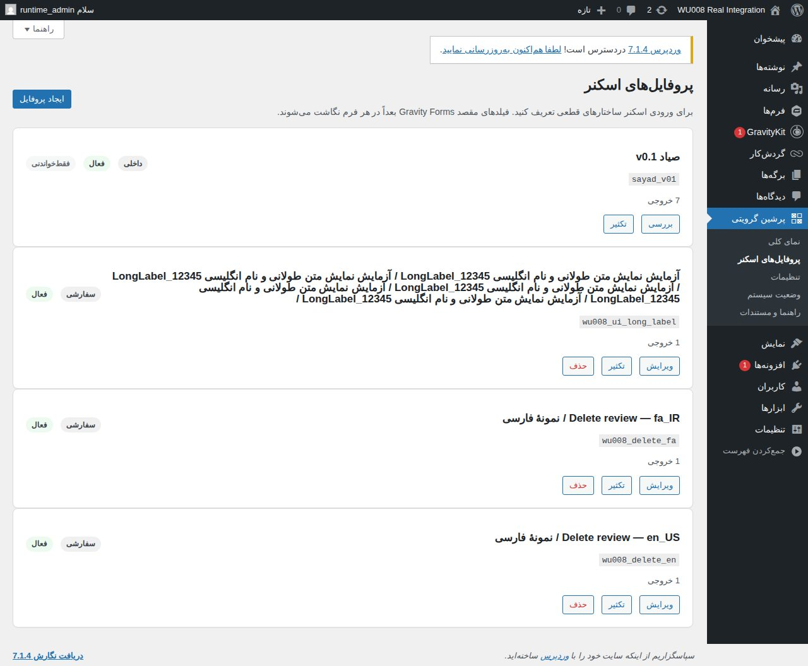

[confirmation — full screenshot](fa_IR-1280-confirmation.jpg)

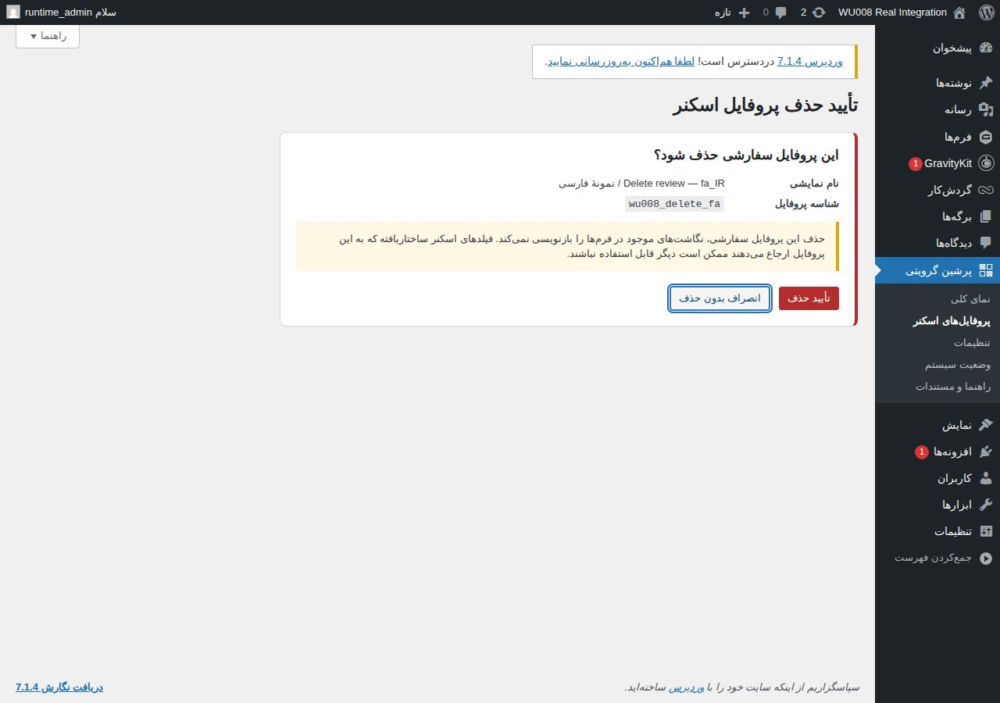

[cancel — full screenshot](fa_IR-1280-cancel.jpg)

[missing — full screenshot](fa_IR-1280-missing.jpg)

[built-in — full screenshot](fa_IR-1280-built-in.jpg)

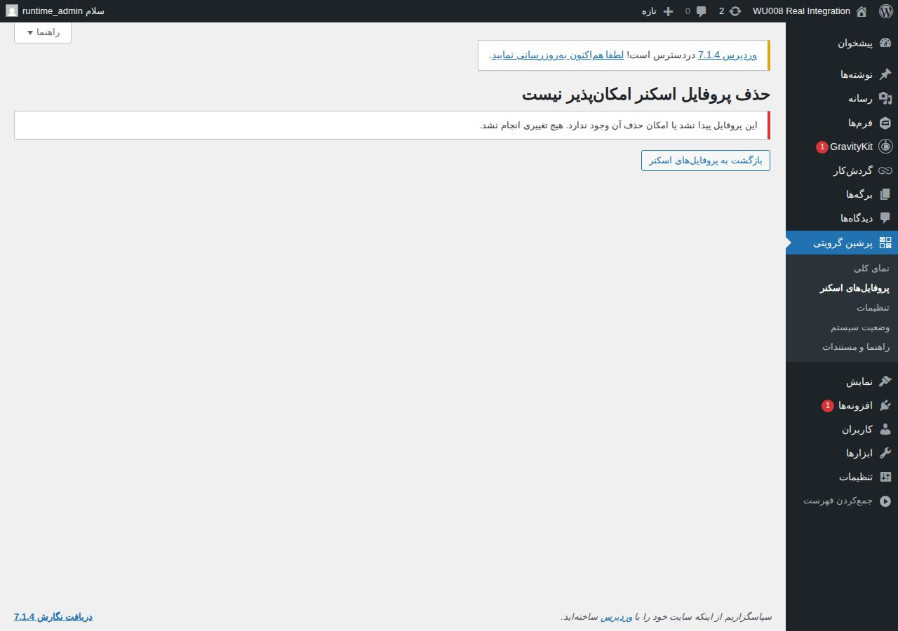

### 390 CSS px

[list — full screenshot](fa_IR-390-list.jpg)

[confirmation — full screenshot](fa_IR-390-confirmation.jpg)

[cancel — full screenshot](fa_IR-390-cancel.jpg)

[missing — full screenshot](fa_IR-390-missing.jpg)

[built-in — full screenshot](fa_IR-390-built-in.jpg)

### 320 CSS px

[list — full screenshot](fa_IR-320-list.jpg)

[confirmation — full screenshot](fa_IR-320-confirmation.jpg)

[cancel — full screenshot](fa_IR-320-cancel.jpg)

[missing — full screenshot](fa_IR-320-missing.jpg)

[built-in — full screenshot](fa_IR-320-built-in.jpg)

[deleted — full screenshot](fa_IR-320-deleted.jpg)

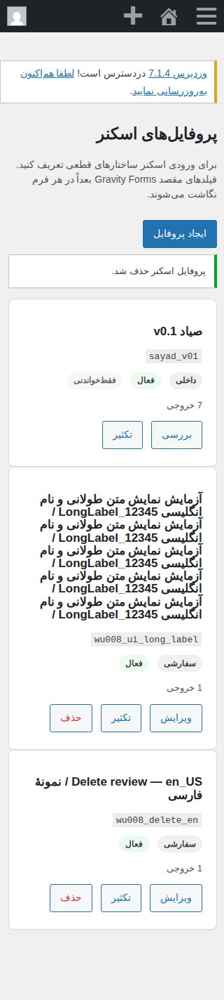

[stale — full screenshot](fa_IR-320-stale.jpg)

## en_US

- Direction: LTR
- Genuine registered profile removed by authenticated **POST**, and original GFAPI field metadata unchanged
- Destructive GET, wrong ID, invalid/missing nonce, wrong name, built-in, anonymous and repeated POST rejected
- The destructive Confirm has a computed solid-red default/hover/keyboard-focus treatment, WCAG AA text contrast (>=4.5:1), and visibly differs from the neutral Cancel in every tested viewport
- At 320 CSS px, navigation, Cancel and Confirm work with **JavaScript disabled**

### 1280 CSS px

[list — full screenshot](en_US-1280-list.jpg)

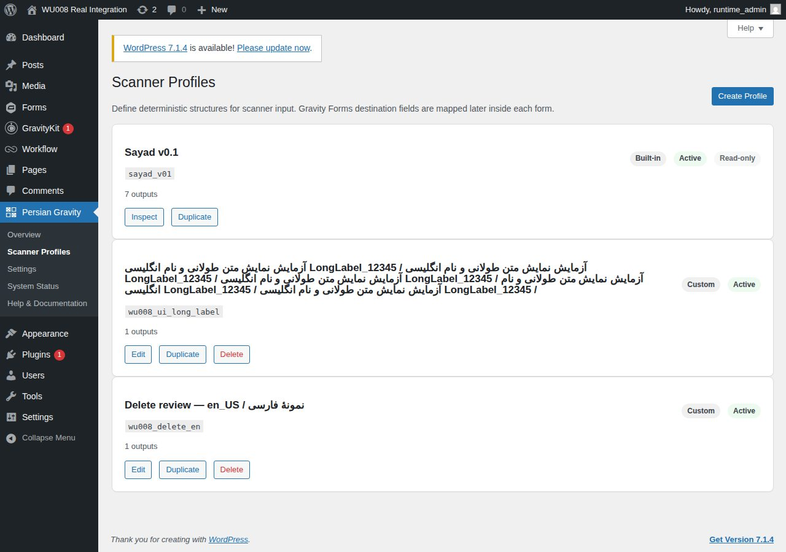

[confirmation — full screenshot](en_US-1280-confirmation.jpg)

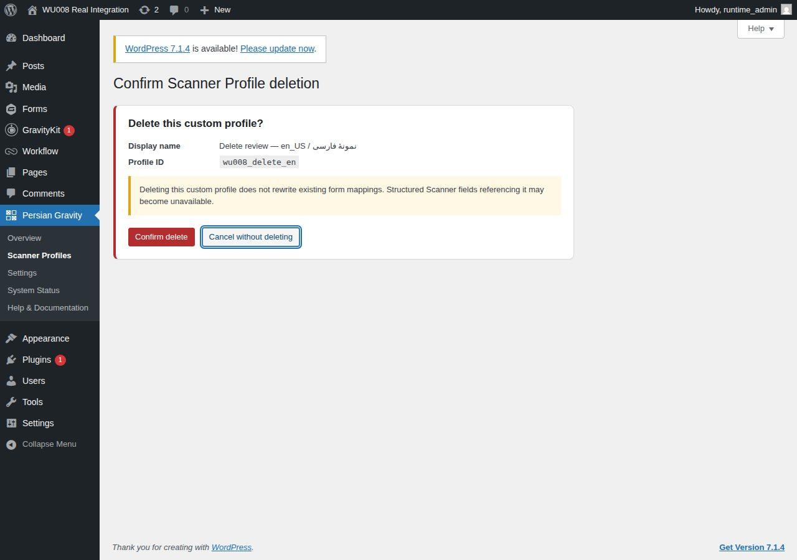

[cancel — full screenshot](en_US-1280-cancel.jpg)

[missing — full screenshot](en_US-1280-missing.jpg)

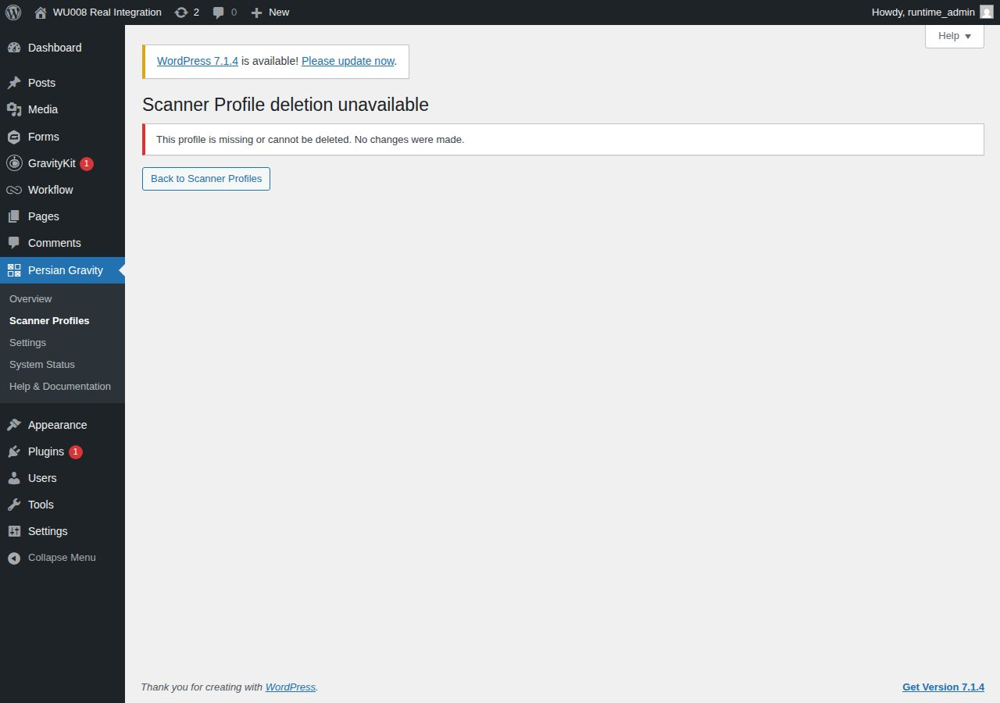

[built-in — full screenshot](en_US-1280-built-in.jpg)

### 390 CSS px

[list — full screenshot](en_US-390-list.jpg)

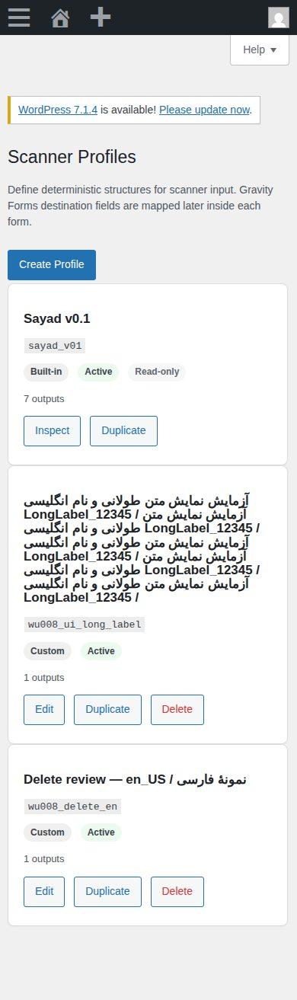

[confirmation — full screenshot](en_US-390-confirmation.jpg)

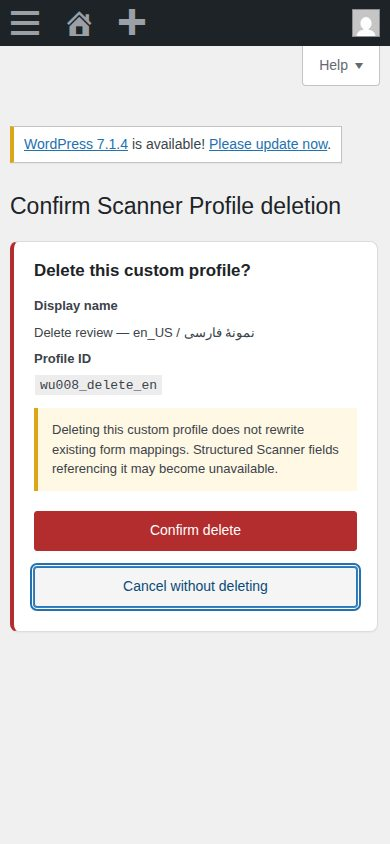

[cancel — full screenshot](en_US-390-cancel.jpg)

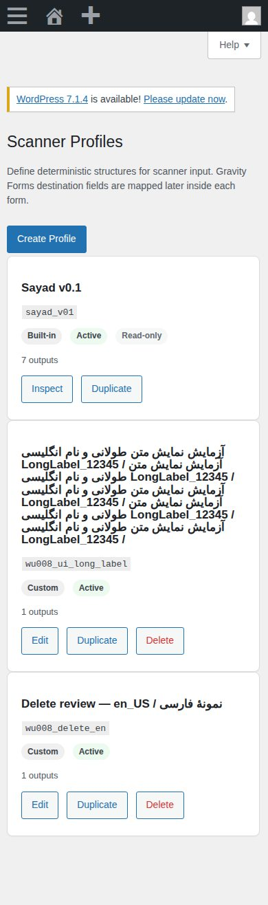

[missing — full screenshot](en_US-390-missing.jpg)

[built-in — full screenshot](en_US-390-built-in.jpg)

### 320 CSS px

[list — full screenshot](en_US-320-list.jpg)

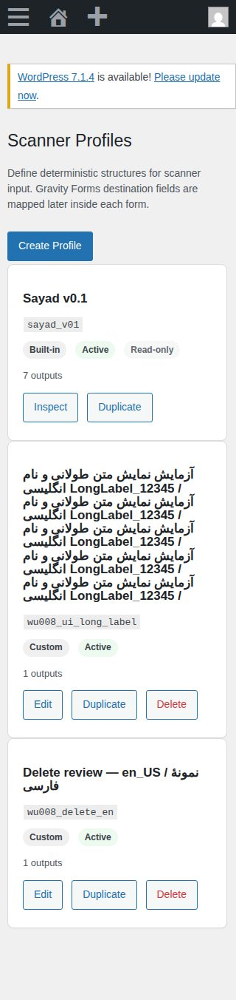

[confirmation — full screenshot](en_US-320-confirmation.jpg)

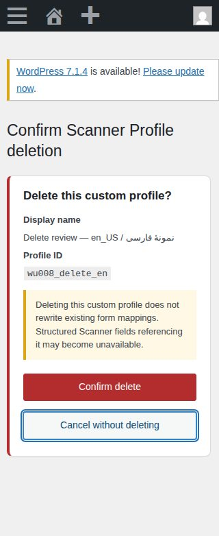

[cancel — full screenshot](en_US-320-cancel.jpg)

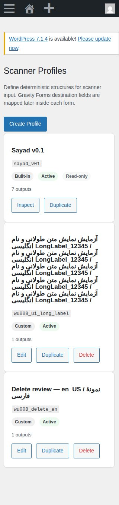

[missing — full screenshot](en_US-320-missing.jpg)

[built-in — full screenshot](en_US-320-built-in.jpg)

[deleted — full screenshot](en_US-320-deleted.jpg)

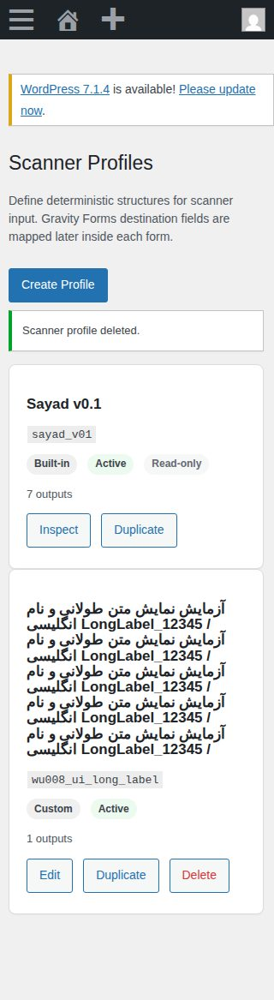

[stale — full screenshot](en_US-320-stale.jpg)

## Limitations

- No real users or screen-reader announcements were tested.
- This is an exact disposable WordPress/Gravity Forms runtime, not production.
- No form metadata was rewritten in the executed test; this is not a census of all production forms.
